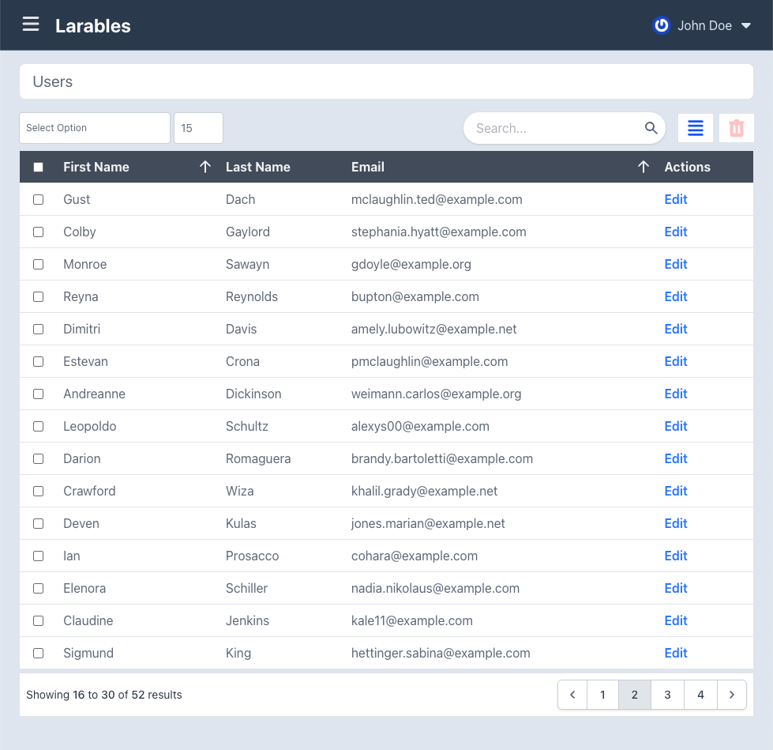

# Larables

- [About](#About)
- [Installation](#Installation)
- [Setup](#Setup)
- [Getting Started](#Getting-Started)
- [Settings](#Settings)
- Advance Configuration
    - Actions
        - [Defining General Row Actions](#Defining-General-Row-Actions)
        - [Defining Individual Row Actions](#Defining-Individual-Row-Actions)
        - [Supported Row Actions](#Supported-Row-Actions)
        - [Custom Row Actions](#Custom-Row-Actions)
    - Bulk Options
        - [Defining Bulk Options](#Defining-Bulk-Options)
    - Checkboxes
        - [Display or Remove Individual Row Checkbox](#Display-or-Remove-individual-Row-Checkbox)
    - Columns
        - [Customizing Column Display Content](#Customizing-Column-Display-Content)

## About

Generate data tables using PHP classes.



## Installation

Install with `composer require njdigitallab/larables`.

## Setup

Publish the package assets with `php artisan vendor:publish --tag=larables-assets`.

Include the `vendor/larables/js/larables.js` script and`vendor/larables/css/larables.css` stylesheet in your html markup.

## Getting Started

Create a class and extend the Larables Table class. All configurations will be placed inside this class as property values or using getter methods.

```php
<?php

namespace App\Tables;

use Larables\Table;

class UsersTable extends Table
{

}
```

Then in your controller, create an instance of the table by calling the static `make` method and pass it to your view in a variable named `$table`.

```php
<?php

namespace App\Http\Controllers;

use App\Tables\UsersTable;

class UserController extends Controller
{
    public function index()
    {
        $table = UsersTable::make();
        return view('users.index', compact('table'));
    }
}
```

In the content area of your view file, include the larables partial view. This view is already setup to render your table based on your class setup.

```html
@include(Larables::viewsId().'::larables')
```

Finally, you will need a data source to work with. The package is configured to work with models supplied from the database. We need to define a `baseQuery` method in your table class and return an instance of the Eloquent Builder. 

```php
<?php

namespace App\Tables;

use Illuminate\Database\Eloquent\Builder;
use Larables\Table;

class UsersTable extends Table
{
    public function baseQuery(): Builder
    {
        return User::query();
    }
}
```

DO NOT finish the query as this will be handled by the package. Pagination, sorting and searching are package features and can be handled automatically.

## Settings

```php
// The visible table columns. These should be key => value pairs.
// The key being the column id, while the value is the column title.
protected array $columns = [];

// The column ids that are sortable.
// Only visible columns can be sortable.
protected array $sortColumns = [];

// The sort by key.
protected string $sortKey = 'sort_by';

// The order key.
protected string $orderKey = 'order_by';

// Whether to allow multiple sorting.
protected bool $allowMultipleSorting = false;

// The column ids that are searchable.
// A column does not have to be visible to the user to be searchable.
protected array $searchColumns = [];

// The search name for the HTTP request.
protected string $searchKey = 'search';

// Should display the search field.
protected bool $displaySearch = true;

// If to use checkboxes. If enabled, they will be placed as the starting column.
protected bool $hasCheckbox = false;

// The name attribute for the checkbox.
protected string $checkboxName = 'checkbox';

// The name of the model/entity key, that is used to set the checkbox value.
protected string $checkboxIdField = 'id'; // may prefer using uuid

// If to add the actions column
protected bool $hasActions = false;

// The type of content for the action. Accepts 'text' or 'icon'.
protected string $actionContentType = 'text';

// The element to wrap the action content in. Accepts 'button' or 'link'.
protected string $actionDisplayType = 'link';

// The list of actions.
protected array $actions = [
    'view' => ['route_name' => 'users.view', 'method' => 'get'],
    'edit' => ['route_name' => 'users.edit', 'method' => 'get'],
    'trash' => ['route_name' => 'users.trash', 'method' => 'patch'],
];

// Whether to display bulk options
protected bool $displayBulkOptions = true;

// The key for the bulk action. This is the name sent with the HTTP request.
protected string $bulkActionKey = 'bulk_action';

// The key that holds the current page value.
protected string $pageKey = 'page';

// The key that holds the total items per page value.
protected string $perPageKey = 'per_page';

// The default number of items to display per page.
// It is best to set this to a number that is returned from the getPerPageOptions method.
protected int $perPageTotal = 15;

// Get the maximum per page total. This is a fail safe so that users don't crash the browser,
// by overloading the request.
protected int $maxPerPageTotal = 1000;

// Indicate whether we should paginate the query.
protected bool $paginate = true;

// Indicate whether we should display the pagination links.
protected bool $displayPagination = true;

// Whether we should display the total number of items per page options.
protected bool $displayPerPageOptions = true;

// Whether to display the active section icon.
protected bool $displayActiveSection = true;

// Whether to display the trash section icon.
protected bool $displayTrashSection = false;

// The section that is current. 'active' and 'trash' is reserved by us.
protected string $currentSection = 'active';

// The name for the section used in the HTTP request query.
protected string $sectionKey = 'section';

// The message to display when no items to display.
protected string $noItemMessage = 'There is nothing to display.';

// Indicate whether the table footer should be displayed.
protected bool $displayTfoot = false;

// Whether we should display the top bar that contains the filters.
protected bool $displayTopBar = true;

// Whether we should display the bottom bar which contains the pagination.
protected bool $displayBottomBar = true;
```

## Advance Configuration

### Defining General Row Actions

To define actions, add key value pairs to the actions array property. The key will be the action id while the value will be an associative array that contains details to construct and process the action as shown below.

```php
<?php

namespace App\Tables;

use Larables\Table;

class UsersTable extends Table
{
    protected array $actions = [
        'edit' => [
            'route' => 'https://home.com',
            'route_name' => 'home',
            'args' => ['animal' => 'fish', 'specie' => 'snapper'],
            'pass_model' => true,
            'method' => 'get',
        ],
    ];
}
```
`route` - The explicit url to go to when the action is clicked. No other information passed will be processed.

`route_name` - The route name to generate the url for when the action is clicked on.

`args` - An array of query args to pass to the route name.

`pass_model` - If to pass the model to the route name. This defaults to true. If defined as true, it will only be passed when the args key is empty.

`method` - The HTTP request method to use. This defaults to `get`. Accepts `get`, `post`, `put`, `patch`, `delete`.

### Defining Individual Row Actions

To filter which actions a particular row should have, add your computation to a `getItemActions` method.

```php
<?php

namespace App\Tables;

use Illuminate\Support\Facades\Auth;
use Larables\Table;

class UsersTable extends Table
{
    public function getItemActions(mixed $item): array
    {
        $actions = $this->getActions();

        if (Auth::user()->cannot('trash', $item)) {
            unset($actions['trash']);
        }

        return $actions;
    }
}
```

### Supported Row Actions

The supported row actions are `view`, `edit`, `trash`, `restore`, `destroy`.

### Custom Row Actions

You can add actions that are not supported. Whatever the action key is, the system will convert the key to a studly version for it's text display. Or, you can configure the title to display by defining `get{Action}ActionText` method and return a value.

```php
<?php

namespace App\Tables;

use Larables\Table;

class UsersTable extends Table
{
    public function getDownloadActionText()
    {
        return 'Downloads';
    }
}
```

If you are displaying an icon instead of text, in a `get{Action}ActionIconHtml` method, return an html string with the icon's markup.

```php
<?php

namespace App\Tables;

use Larables\Table;

class UsersTable extends Table
{
    public function getDownloadActionIconHtml()
    {
        return "";
    }
}
```

### Defining Bulk Options

Return the bulk options in a `getBulkOptions` method.

```php
<?php

namespace App\Tables;

use Larables\Table;

class UsersTable extends Table
{
    public function getBulkOptions(): array
    {
        return [
            [
                'value' => 'trash', 
                'title' => 'Trash', 
                'route' => '', 
                'request_type' => 'patch', 
           ],
        ];
    }
}
```
`value` - The value sent with the HTTP request under the name set for the `$bulkActionKey`.

`title` - The display text in the select box.

`route` - The route to fire off the HTTP request to.

`request_type` - The HTTP request type.

### Display or Remove Individual Row Checkbox

You can determine if a particular row checkbox should be displayed by doing your computation in the `itemHasCheckbox` method.

```php
<?php

namespace App\Tables;

use Illuminate\Support\Facades\Auth;
use Larables\Table;

class UsersTable extends Table
{
    public function itemHasCheckbox(mixed $item): bool
    {
        return Auth::user()->can('destroy', $item);
    }
}
```

## Customizing Column Display Content

Once a column id matches the model property, the model property value will automatically be displayed as the column content. However, if you have a column id that does not correspond to a model property, you can customize the column content. For example, if we want to display content for column id name, we call the `get{ColumnId}ColumnContent` method:

```php
<?php

namespace App\Tables;

use Larables\Table;

class UsersTable extends Table
{
    protected array $columns = [
        'name' => 'Name',
        'email' => 'Email',
    ];

    public function getNameColumnContent($model, $columnNumber, $rowNumber)
    {
        return $model->first_name.' '.$model->last_name;
    }
}
```

